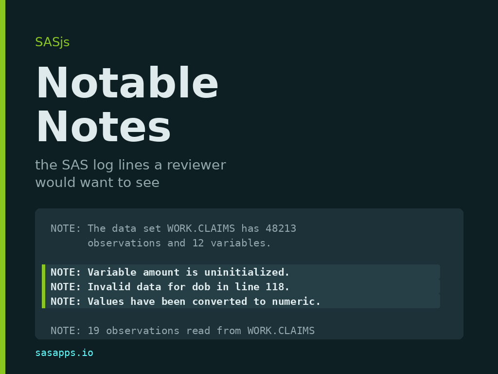

A SAS log is mostly notes. A single evening of `PROC` steps will print thousands of `NOTE:` lines, and almost none of them means anything: how many observations were read, how many were written, how long a step took. Then SAS prints, in exactly the same format and the same colour, a note that says a variable was never initialised, or that a date failed to convert. That line is the bug. It sits between two hundred lines that are not.

This post is about the small idea we added to the SASjs tooling this week: sort the notes into two piles, print one pile, and throw the other away. It covers where the list of "notes worth reading" came from, the other people who have solved this problem, and how the same list is applied in `@sasjs/utils`, `sasjs logcheck`, SASjs Server and the SASjs VS Code extension.

## The idea - a closed list

Every log-checking tool arrives at the same compromise:

* report every `ERROR` and every `WARNING`, because those are unambiguous, and
* report a `NOTE` only when its text matches one of a small, fixed set of phrases that mean something went quietly wrong.

That fixed set is what we call the **notable notes**. It is deliberately short, deliberately closed, and it is the whole of the idea. The notes that make it are not failures: SAS completed the step, allocated the data set, and returned. The step simply did something the programmer did not ask for, and SAS mentioned it in passing:

```text
NOTE: Variable amount is uninitialized.
NOTE: Invalid data for dob in line 118 3-9.
NOTE: Character values have been converted to numeric values.
NOTE: The meaning of an identifier changed at line 4021.
NOTE: A CASE expression has no ELSE clause.
NOTE: MERGE statement has more than one data set with repeats of BY values.
NOTE: At least one W.D format was too small for the number to be printed.
```

and, in the statistical procedures, a group of notes that would otherwise be lost entirely:

```text
NOTE: Some tick values have been thinned.
NOTE: An infinite likelihood is assumed in iteration 5.
NOTE: Estimated G matrix is not positive definite.
NOTE: Processing on disk occurred during summarization.
```

None of those stops a batch job. All of them change a result. A reviewer wants to see every one, and wants to see nothing else.

## Where the list came from

We did not invent the phrases, and we did not want to. Writing a keyword list by hand from memory produces a list of messages the author happened to hit last month.

### SASLogChecker

The list we ship comes from [SASLogChecker](https://github.com/Morioka-Yutaka/SASLogChecker), by Yutaka Morioka, released under the MIT licence. It is a set of SAS macros that scan a log window or a directory of logs and summarise the `ERROR`, `WARNING` and notable `NOTE` messages they find.

Three things made it the source rather than merely a reference:

* **It has a specification.** `Note_spec_1.0.xlsx` in the repository lists every target message with a minimal reproducing program, the message as SAS prints it in Japanese, the same message in English, the keyword to match, and the keyword's hexadecimal form. That is a test matrix, not an anecdote.
* **It is old enough to be upstream.** Its first commit (July 2025) already carried the list, so the direction of travel is settled - we took from it.
* **It carries the statistical notes.** The user-group papers (below) catalogue data-step problems and stop short of `PROC MIXED`.

One detail from reading it is worth recording, because it explains the shape of our list. The macro matcher greps hex-encoded Japanese text, because it reads logs from a Japanese Windows SAS session - a term in the macro looks like this:

```sas
term="8C8791B9926C82F08ADC82F182BE8C768E5A"x
```

So the English wording in our list comes from the specification spreadsheet's "Message (English)" column, not from the matcher. The consequence for us is a known limitation: our parser matches English text only, so a Japanese-language SAS log yields no notable notes from it.

### The conference papers

The SAS user-group literature has solved this problem several times over. All of these were read in full, not skimmed from a search result:

* **SUGI 31, paper 128-31 (2006)** - "You've Got E-Mail: Automatic Log Checking via E-Mail Notification" ([PDF](https://support.sas.com/resources/papers/proceedings/proceedings/sugi31/128-31.pdf)). The oldest. Greps six strings and sets a macro variable when one is found.
* **SAS Global Forum 2012, paper 042-2012** - "Log Checks Made Easy", Yogesh Pande ([PDF](http://support.sas.com/resources/papers/proceedings12/042-2012.pdf)). A `%log_check` macro over a folder of `.log` files, tabulated with `PROC REPORT`. Its list is ten categories rather than ten strings: errors, warnings, uninitialised variables, format not found, repeated `BY` values in a merge, `DROP`/`KEEP`/`RENAME` lists never referenced, decimal shift, unresolved symbolic reference, overwritten variables, and `LENGTH` not first.
* **SAS Global Forum 2017, paper 1173-2017** and **MWSUG 2017, paper TT02** - "Check Please: An Automated Approach to Log Checking" ([PDF](https://support.sas.com/resources/papers/proceedings17/1173-2017.pdf), [PDF](https://www.mwsug.org/proceedings/2017/TT/MWSUG-2017-TT02.pdf)). The same paper delivered twice. Lists eight common messages - the recurring core of the vocabulary.
* **PharmaSUG 2008, paper CC02** - "%LOGCHECK: a Convenient Tool for Checking Multiple Log Files", Suzanne Humphreys. `FILENAME PIPE` over a directory of logs, SAS 9.1.3, Windows, interactive. No additional vocabulary, but the report layout everyone copies.

These are background, not the source: their lists are shorter, worded differently, and none contains the statistical notes. Where we agree with them is on the shape of the answer - every one of them decided that a `NOTE` is worth reporting only when it matches a known phrase.

### Two implementations worth reading for other reasons

* [**vdebbeti/SAS-Log-checker-CLI**](https://github.com/vdebbeti/SAS-Log-checker-CLI) is 89 lines of Python with one regex anchored to the message prefixes, so a `NOTE:` inside a quoted string or a printed data set does not match. It reports every note and has no keyword list at all - but its command line (`--fail-on error|warning|note|none`, JSON output) is a good shape, and we borrowed it for `sasjs logcheck`.
* [**SAS Institute's own VS Code extension**](https://github.com/sassoftware/vscode-sas-extension) parses `ERROR` and `WARNING` only, and no notes at all - the opposite decision. Its value is elsewhere: `logParser.ts` maps a message back to the source line using the pointer lines SAS prints (a run of dashes, then the column numbers under the token). Two rules we took from it: a pointer line must not be absorbed into the message above it, and a log viewer that is not attached to an editor should still report positions in the log text.

### Where to find the papers - saslexicon.org

The papers above were mostly found at [**SAS LEX.ICON**](https://saslexicon.org), the community archive Lex Jansen built and which is now maintained in his memory. It indexes the proceedings of sixteen SAS user-group conferences - SUGI/SGF, MWSUG, PharmaSUG, PHUSE, WUSS, SESUG, NESUG and the rest - with 37,396 papers and presentations, each searchable by title, author, abstract and keyword, going back to 1976.

Two reasons to use it rather than a search engine. First, the papers are not always still at the URL a citation gives: the [PharmaSUG 2008 index](https://saslexicon.org/PharmaSUG/2008/PharmaSUG_2008.html) is where that paper can currently be found. Second, the archive carries the abstract for every entry, which is what lets you tell in ten seconds whether a log-checking paper has a vocabulary in it or only a report layout. It is a hosting location, not a publisher - all copyrights stay with their owners.

## The list, as SAS Packages

SASLogChecker is distributed as a [SAS package](https://github.com/yabwon/SAS_PACKAGES), so if you want to run the original rather than read it, you install it with the SAS Packages Framework by Bartosz Jablonski:

```sas
filename packages "/path/to/your/packages";
%include packages(SPFinit.sas);

%installPackage(SASLogChecker,
  sourcePath=https://github.com/Morioka-Yutaka/SASLogChecker/raw/main/)
%loadPackage(SASLogChecker)
```

`%interact_logchk` checks the current log window; `%logchk2directory(folder=..., out_folder=...)` walks a directory and writes summary reports. The framework's own archive, [SASPAC](https://github.com/SASPAC), is where to look for others - it carries `sasjscore` alongside SASLogChecker.

## How it is implemented in SASjs

The list is one thing; the parser is another. We put the parser in one place, because the alternative - an editor plugin, a browser pane and a CI gate each with their own regex - is how a log starts reading differently depending on where you open it.

### 1. `@sasjs/utils/logs`

Since `@sasjs/utils` 4.2.0 the library publishes a `logs` subpath with two pure functions and no imports at all, which is what lets the same code run in Node, in a browser bundle and inside an editor extension:

```ts
import { parseLog } from '@sasjs/utils/logs'

const issues = parseLog(logText)
for (const issue of issues) {
  // issue.line, issue.column, issue.endLine, issue.endColumn
  // issue.severity: 'error' | 'warning' | 'note'
  // issue.code?: '22-322'   issue.message: the folded text
}
```

`parseLog` returns every `ERROR` and `WARNING`, and a `NOTE` only when its message matches `NOTE_KEYWORDS` - thirty patterns, matched case-insensitively against the folded message:

```ts
const NOTE_KEYWORDS = [
  'is uninitialized',
  'Missing values were generated',
  'Invalid data',
  'have been converted to',
  'too small for',
  'repeats of BY values',
  'LOST CARD',
  'NOEXEC',
  'have been thinned',
  'infinite likelihood',
  'not positive definite'
  // ...and nineteen more
]

export const isNotableNote = (message: string): boolean =>
  NOTABLE_NOTE.test(message)
```

The details that matter, and why:

* **The match runs on the folded message.** SAS wraps a long note over several physical lines, so a keyword can land on the second line. Wrapped lines are folded into one issue first (up to a limit, so a malformed log cannot run away), and one problem is reported as one issue rather than one per line.
* **Only the colon form counts for notes.** `NOTE:` is a message; any line beginning `NOTE` is not, and matching the latter would readmit the whole notes stream. A coded note (`NOTE 49-169:`) is a note and keeps its code, because the code is what `--ignore-code` keys on.
* **`ERROR` and `WARNING` also match without the colon**, in the form SAS writes when it continues a message: `ERROR Libref X is not assigned.`
* **Thirty keywords are one regex.** Testing thirty `includes` calls per note, over a log holding thousands of notes, was measurably slower than one alternation; the module's other hot path is a fast return from `clean()` when a line carries no markup and no double space.
* **Nothing is split into lines.** A 16 MB log becomes millions of strings if you build an array of lines. One global regex pass over the text, with line numbers counted forward from the previous match, costs a fraction of that.
* **ODS HTML logs parse too.** A tag sequence before the marker is skipped and markup is stripped from the reported message, so the same parse serves a plain log and an HTML one.
* **`isSasLog` is the guard.** A Python log writes `ERROR:root:boom` and a shell build log writes `ERROR: Command failed with exit code 1`. The marker alone proves nothing, so the test looks for what only SAS prints about itself: the banner, a coded marker, or padded step numbers. A host that publishes diagnostics treats a false answer as "not obviously SAS" rather than "not SAS" - a trimmed excerpt carries none of the three.
* **`nextIssue(issues, line, direction)`** walks the list with wrap-around, which is the behaviour both a "next problem" and a "previous problem" button need.

`@sasjs/sas-language` re-exports the same functions as `@sasjs/sas-language/logs`, for hosts that load that package and nothing else. There is one implementation behind both entry points.

### 2. `sasjs logcheck` - the CLI

Since `@sasjs/cli` 6.7.0 there is a command that needs no target, no login and no project: a log from Enterprise Guide or from a server somewhere else checks the same way.

```bash
sasjs logcheck                       # every log in sasjsresults, fail on any ERROR
sasjs logcheck ./logs                # every file under ./logs, skipping non-SAS logs
sasjs logcheck run.log --fail-on warning
sasjs logcheck --max-warnings 10
sasjs logcheck --ignore-code 49-169  # the note about a truncated quoted string
sasjs logcheck --format annotations  # GitHub Actions annotations
```

`--format json` is there for a pipeline that wants to read the result rather than print it, and `--format annotations` underlines each issue in the workflow log. The policy lives in `sasjsconfig.json` so it can be reviewed like any other project setting, and the command-line flags override it:

```json
{
  "logCheck": {
    "failOn": "error",
    "maxWarnings": 10,
    "ignoreCodes": ["49-169"],
    "ignorePaths": ["sasjsresults/legacy"],
    "folder": "sasjsresults",
    "autoCheck": false
  }
}
```

The design decision worth stating plainly is the default: `failOn` is `error`, not `note`. A notable note is what legacy code produces in bulk, and a gate that goes red on day one gets switched off on day two. The notes are reported - the run does not fail on them unless you ask.

The same check rides along with the commands that already receive a log - `run`, `request`, `job execute`, `flow execute` and `fs deploy`/`fs sync`. It prints the issues it finds, and fails the command only when `--logcheck` was passed or `logCheck.autoCheck` is on, because the exit code of a deploy is load-bearing in a pipeline and is not something to change behind a project's back.

### 3. SASjs Server - the Studio log pane

Since SASjs Server 3.7.0 the Studio log pane parses with the same `parseLog`. The log is still handed to the viewer exactly as SAS wrote it - nothing is rewritten and nothing is highlighted by injecting markup, so a doxygen header's `<h4> SAS Macros </h4>` stays text.

What the pane does with the issue list:

* the tab carries an error icon and a warning icon when the log holds either, so a failed run is visible without opening the pane;
* the issue list for each chunk is built from the same parse, and clicking an entry jumps to its line in the log;
* notable notes are listed with the errors and warnings, and can be switched off with the eye button on the tab - the same switch, `log.notableNotes`, exists on the settings page. It defaults to on. With it off, the pane carries errors and warnings only.

Large logs are rendered in chunks of 20,000 lines by default, each chunk a substring of the log rather than an array of lines, so the text is held once however long it is. The issue list is then the fast way to find the interesting line rather than a scroll through the whole log.

### 4. The SASjs VS Code extension

Since SASjs for VS Code 2.12.0, opening a `.log` file gives you the same findings in the editor:

* the error and warning lines are coloured in the log, and the arrows in the editor title bar step between them from the cursor, wrapping at the end;
* every issue is published to VIEW -> PROBLEMS, next to the lint issues, so F8 and Shift+F8 walk them and a click jumps to the line;
* notable notes are published as **Information** rather than as problems, so errors stay at the top of the list;
* the eye button in the title bar toggles them, and writes `sasjs-for-vscode.logNotableNotes` into the project's `.vscode/settings.json` - the setting and the button are the same switch, so a team can commit the choice;
* a `.log` written by something else is left alone, via the same `isSasLog` test, and a log over 32 MB is not parsed at all. Edits are debounced, so typing in a log does not re-parse on every keystroke.

The log text is untouched in every host. The parse produces positions; the host draws.

## Keeping the list

Two rules, and they are the reason the list can be maintained at all.

**Credit travels with the data.** Every keyword in `NOTE_KEYWORDS` sits next to a comment saying where the list came from and which message each entry catches. If you add one, say where you got it, at the point of the addition. A list of phrases with no provenance cannot be reviewed, because the next person cannot tell a deliberate choice from a typo.

**Keep it short and closed.** Adding a keyword widens what every host reports - the editor, the Studio pane and every pipeline that runs `sasjs logcheck`. A message belongs on the list when a reviewer would want to see it even though SAS called it a note. That test rejects most candidates, which is the point.

Known limitations, stated rather than hidden: the matcher is English-only, so a Japanese-language log reports no notable notes; and the list is a fixed set of phrases, so a message SAS rewords in a future release drops off silently until someone adds the new wording.

## Links

* [SASLogChecker](https://github.com/Morioka-Yutaka/SASLogChecker) - Yutaka Morioka, MIT. The source of the list.
* [SAS Packages Framework](https://github.com/yabwon/SAS_PACKAGES) and the [SASPAC archive](https://github.com/SASPAC) - how SASLogChecker is distributed.
* [SAS LEX.ICON](https://saslexicon.org) - the user-group proceedings archive, 37,396 papers.
* [sasjs/utils](https://github.com/sasjs/utils) - `src/logs/sasLog.ts`, the parser and the list.
* [sasjs/cli](https://github.com/sasjs/cli) - `src/commands/logcheck`, the `logcheck` command and the automatic check.
* [sasjs/server](https://github.com/sasjs/server) - the Studio log pane.
* [sasjs/vscode-extension](https://github.com/sasjs/vscode-extension) - `src/logs/logDiagnostics.ts`, decorations and Problems.
* [sassoftware/vscode-sas-extension](https://github.com/sassoftware/vscode-sas-extension) - the SAS Institute parser, for pointer-line handling.
* [vdebbeti/SAS-Log-checker-CLI](https://github.com/vdebbeti/SAS-Log-checker-CLI) - the command-line shape we borrowed.

`sasjs logcheck --format annotations` is the quickest way to try the idea: point it at a folder of last month's logs and see what has been printing a note you never read.
