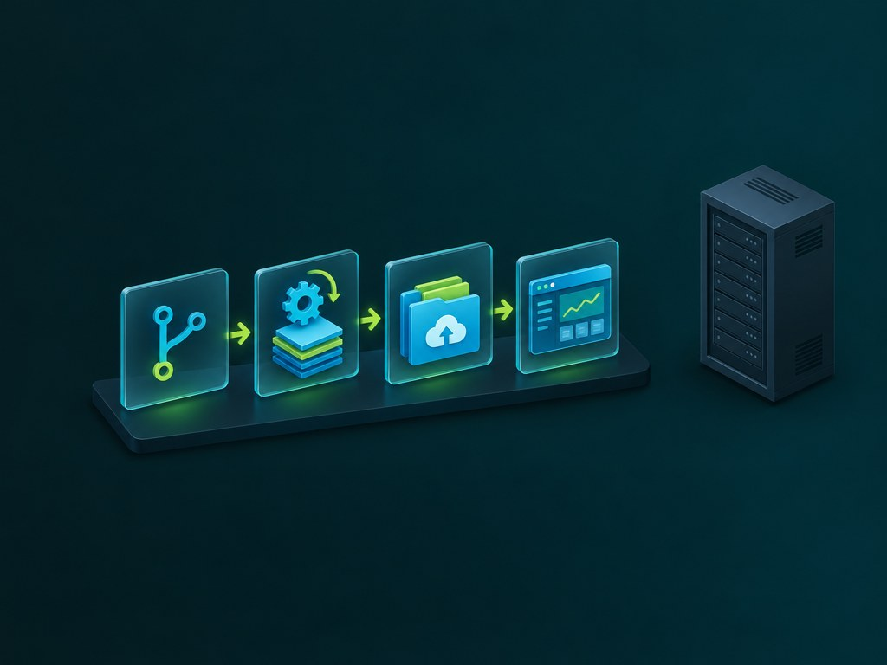

Most SAS estates are hardened at the network edge, and then opened up again by the number of people who need a way in. Building a web front end against one takes standing access: network reach, an identity, a credential, somewhere to write the code and usually a copy of the data. Each of those is a route into a system that holds the organisation's most sensitive analytics - granted to a developer whose job is to render a page.

Mocked backends take that requirement away. The front end is developed against a JavaScript implementation of the same services, so the development loop never touches SAS. This article sets out the risk that pattern addresses, what it removes from circulation, when it pays for itself, where its limits are, and how to build one.

## The risk is not the server, it is everything that touches it

A hardened server is worth little if twenty laptops hold credentials for it. Breaches that begin on a developer machine are a well documented route into a server estate, and they are not exotic: a phishing link, a malicious package in a dependency tree, a compromised browser extension, a personal project that shares a shell history. The estate is rarely the target; it is what the credentials on that machine unlock.

The problem is structural rather than a matter of discipline, and each requirement compounds the last:

- **Every developer needs standing access.** Not one key: a VPN profile, a database login, an OAuth client, a long-lived token, an app location they can write to.
- **Those credentials have to live somewhere.** On a laptop, in a shell history, in a `.env` file, in a CI secret that someone also uses locally, in a screenshot on a ticket.
- **Access is broader than the task.** Roles are usually granted for the whole job rather than the task - a shortcut on cost or effort - so a developer holds more reach than they need, deliberately or accidentally.
- **Rotation never catches up.** Each developer having their own credentials is correct practice, and it is also the scale of the problem: every identity is a standing grant with a token that outlives the project it was issued for. Rotation is a project per person, offboarding is only as good as the list, and a leaked credential is usually discovered after it has been used, not before.
- **The development loop loads production.** Test runs, sample queries and half-finished services all execute on the box that also runs the reporting the business depends on.

The result is a cost that is hard to quantify but easy to recognise. The estate is expensive to protect, because so many people have to be trusted with it, and expensive to run, because it carries work that could be done on a laptop or in a pipeline instead.

## What the development loop asks for today

It is worth writing down, because the list is longer than it feels:

1. Network reach to the SAS server, which usually means a VPN.
2. An identity on that server, with a licence entitlement.
3. A token or client secret, stored somewhere durable.
4. A writeable location, historically in the same folders production services live in.
5. Data that resembles production closely enough to build against.
6. Compute, during working hours, for test runs and restarts.
7. Somebody to grant all of the above, and to remove it later.

Mocked backends remove items 1 to 4 outright. They replace item 5 with a generated fixture, move item 6 onto the developer's machine or into a pipeline, and reduce item 7 to a grant on a source repository.


## What changes when the backend is JavaScript

The mechanism is small. SASjs Server chooses a runtime from the file extension, so `services/common/getdata.js` is a service in exactly the same sense as `getdata.sas`. Where the service folder is the contract, the front end cannot tell which one it is talking to. There are two ways to run a backend like that, and both matter here.

A **JavaScript-runtime server** (`RUN_TIMES=js`) deploys and executes the services on a real drive with real sessions. It is a SASjs Server, not a SAS one: a lightweight Node process that can sit on a laptop, in a container, or on a small internal host with nothing else on it.

The **browser build** goes further. `mockWeb` in `streamConfig` makes `sasjs build` emit a second artefact - your frontend, your compiled services, a service worker and a small runtime - in which the backend runs in the browser. The service worker intercepts the calls the adapter makes, runs the matching program, and resolves `webout`, log and headers back to the app. There is no server.

Whichever of the two you run, the estate drops out of the picture in the same way.


### The estate is not on the path

There is no network route from the developer's machine to SAS, so no firewall rule has to be opened and no address allowed through. The strongest configuration also becomes the easiest: the SAS environment accepts traffic only from its own production ranges, and the web tier that serves the application sits outside them. A compromised laptop then finds no SAS endpoint to authenticate to, because no credential for one is on it.

That is the property worth paying for. It is not that the developer is trusted more; it is that they no longer need to be.

### There are no credentials to distribute

No client secret. No personal access token. No metadata password on a laptop. No service account shared by four people so the tests can run. Nothing to rotate when somebody leaves, because nothing was issued.

What remains is a git account, which the organisation already governs, and a build that produces static files. The token surface of the whole development life cycle collapses to the source repository.

### Nobody needs VPN access to build a front end

VPN membership is a blunt instrument: it grants a foothold in a private network in order to reach a single application. Removing that requirement for front-end developers takes them off the account list that has to be reviewed, recertified and deprovisioned. Contractors and agencies can contribute to a front end without being granted anything inside the network, which matters most for exactly the people it is hardest to justify adding to it.

### Viya does what it was bought for

A Viya environment is an analytics platform. It is sized, licensed and tuned for queries, models and production reporting, not for the deploy per commit that a front end generates during a sprint. Every restart, every test run and every half-built service that lands on it is capacity taken from the work that justifies the licence, and noise in the logs the platform team uses to diagnose real incidents.

Moving development off the estate leaves it carrying the load it was bought for. It also makes the estate's own change control simpler: nothing arrives there except a release.

### The pipeline is faster and safer

A browser-hosted build needs no SAS container, no licence check and no network dependency, so a pull request gets an answer in minutes instead of waiting in a queue behind an environment. It also publishes: the artefact is static files, so a review environment for any branch is a deploy of a folder.



The safety point is less obvious. A mock cannot be reached from the internet, cannot be left running with production data in it, and cannot be the thing an attacker pivots through. The CI estate stops being a second estate to secure.

### Work continues when SAS is not running

Plenty of organisations switch Viya off outside working hours, or restrict it to a maintenance window. Development that depends on it inherits that calendar. A mocked backend has no such dependency: tests run at night, a developer in another time zone is not blocked by a licence server, and a release can be cut on a Saturday without anyone asking for an exception.

### And it lowers the total cost of ownership

None of this is cost-free, but the arithmetic is straightforward. Fewer environments to license and operate. Less cloud spend on dev instances. Less platform-team time granting and revoking access, reviewing firewall rules and restarting servers. Fewer credentials to rotate, and a smaller blast radius when something goes wrong, which is the expensive part of any incident. Shorter onboarding, because a new developer clones a repository and runs two scripts instead of waiting for a ticket to clear.

The same repository still deploys to Viya, SAS 9 or a real server. `mockWeb` is independent of `streamWeb`, so one config serves both the browser build and a normal `sasjs deploy`.

## It is still the real contract

This is not a stub left in a drawer. The mocked app uses the same `@sasjs/adapter` in the browser, the same service names, the same `webout` contract, the same `<sasjs>` element and the same `appLoc`. When the time comes to run against a real backend, nothing in the front end changes - only the target the build was made for.

The services are real services too. The same JavaScript programs deploy to a SASjs Server for development, and shadow the SAS ones on a mixed deployment, because a server chooses the runtime per program. That is what makes the mock worth maintaining: it is the second implementation of a contract you already have, not a fixture bolted to the side of it.

## What it does not protect you from

The boundary is worth stating plainly, because it is easy to forget once a mocked suite is green.

There is no SAS engine in the browser, so a service that reads a SAS table, runs a macro, uses a format or touches CAS cannot work there. Fixtures answer in the shape the real service answers, not with its values, so a mocked run cannot validate a join, an aggregation or a format. The mocked build is a development and review vehicle; anything that needs SAS gets a real target, and the release still has to be exercised against the real thing before it ships.

There is also no authentication in a browser-hosted build. It is single-user and has no authority; do not put one where a permission boundary is supposed to exist, and do not treat a green mocked suite as evidence that authorisation works.

And a mock that drifts from the service it imitates is worse than no mock, because it certifies behaviour that does not exist. Generate the fixture, and fail the build when the two disagree.

## Five working examples

All public, all verified against the live sites at the time of writing.

| Site | What it demonstrates |
|---|---|
| [minimal.sasjs.io](https://minimal.sasjs.io) | The smallest complete case: two services (`appinit`, `getdata`), one generated data file, a plain HTML page. The reference implementation to copy. |
| [angular.sasjs.io](https://angular.sasjs.io) | An Angular app with a file upload and a SAS log panel - and the mocks report logs too, so the panel has something to show with no SAS behind it. |
| [react.sasjs.io](https://react.sasjs.io) | The same shape in React, built from `build/` rather than `src/`, which is where `webSourcePath` earns its keep. |
| [staging.datacontroller.io](https://staging.datacontroller.io) | A commercial product's entire front end - editor, approvals, viewer, admin, Excel maps - on 63 JavaScript services over a captured drive of 64 entries. A visitor can evaluate it without a licence, a VPN or a single credential, and nothing they do reaches a customer estate. |
| [dash.sasjs.io](https://dash.sasjs.io) | Macro Dash, the SASjs platformer, published as a mocked build: three JavaScript services over a six-entry drive, running behind a service worker, so a visitor can play and see the leaderboard persist between visits. |

The scale is what makes the point convincing. The three seed apps are five to eight drive entries and two or three services each. Data Controller is sixty-odd services and a seeded drive, running the same code that ships to customers, which is the difference between a demo and an argument.

You can read the delivered configuration for each of them. It is an ordinary file in the build output:

```
https://minimal.sasjs.io/host/mock-config.json
```

```json
{
  "appLoc": "/Public/app/minimal-seed-app",
  "seedPath": "host/vfs-seed.json",
  "driveEntries": 5,
  "jsPrograms": 2,
  "programFolders": [
    "services",
    "jobs",
    "tests"
  ],
  "snapshot": false,
  "sasTranscript": false,
  "identity": "default",
  "buildStamp": "96e405daa1",
  "builtAt": "2026-11-12T14:49:49.751Z"
}
```

That stamp is worth having on a site you send to people. "Which build am I looking at?" is otherwise a guess.

## How to get started

The quickest start is one of the seed apps - [minimal](https://github.com/sasjs/minimal-seed-app), [Angular](https://github.com/sasjs/angular-seed-app) or [React](https://github.com/sasjs/react-seed-app) - because each already ships a `mock` target, the mock services and a publishing workflow. Copy that structure into your own project. The steps below are what that structure is.

You need Node and a recent SASjs CLI.

### Step 1 - add a mock target

A target, no more:

```json
{
  "name": "mock",
  "serverUrl": "",
  "serverType": "SASJS",
  "appLoc": "/Public/app/minimal-seed-app",
  "streamConfig": {
    "mockWeb": true,
    "mockWebFolder": "sasjsbuild/mock",
    "streamWeb": false,
    "webSourcePath": "src"
  }
}
```

Three things have to be right. `webSourcePath` points at the built frontend: `src` for a hand-rolled page or a framework that serves from source, `build` for Create React App, `client/dist` for a CLI-built Angular app. `appLoc` has to match the location the frontend was built with, because the services are resolved from it: if the page asks for `/Public/app/foo` and the build deployed `/Public/app/bar`, every call misses. And the services that answer in the browser have to be JavaScript, because a target that also compiles `.sas` still builds - with the compiled SAS programs seeded onto the drive for a visitor to read - and the build warns that they cannot run in a browser.

### Step 2 - write the twins

Keep the mock services in a folder that mirrors the real service folders, and add a `syncFolder` so they land on the drive beside the compiled programs:

```
sasjs/
  services/common/getdata.sas      <- the real service
  mocks/services/common/getdata.js <- the twin
```

```json
"serviceConfig": { "serviceFolders": ["sasjs/services/common"] },
"syncFolder": "sasjs/mocks"
```

A service folder is not restricted to `.sas` files. `sasjs compile` copies a non-SAS file through byte for byte - no macro inlining, no header rewriting - and reports the mix:

```
Compiled 0 SAS files; 12 files copied through unchanged (not SAS programs).
Packing 0 SAS services and 12 files.
```

Inside the program you get the same verbs the macro offers. Here is the body of the minimal app's `appinit` twin: it reads a JSON fixture off the drive and answers exactly what `%webout(OBJ, areas)` would have answered.

```js
const path = require('path')

const DRIVE_FILES = path.resolve(weboutPath, '..', '..', '..', 'drive', 'files')
const APP_LOC = String(_program).replace(/\/(services|jobs|tests)\/.*$/, '')
const SPRINGS_FILE = path.join(DRIVE_FILES, APP_LOC, 'services', 'common', 'springs.json')

const springs = JSON.parse(fs.readFileSync(SPRINGS_FILE, 'utf-8'))

const areas = []
const seen = new Set()

springs.forEach((row) => {
  if (seen.has(row.AREA)) return
  seen.add(row.AREA)
  areas.push({ AREA: row.AREA })
})

areas.sort((a, b) => (a.AREA < b.AREA ? -1 : a.AREA > b.AREA ? 1 : 0))

webout('OPEN')
webout('OBJ', 'areas', areas)
webout('CLOSE')
```

Tables arrive the way they do on a real server: the adapter serialises an array of rows as CSV, and the program reads it back through the `_WEBIN_` variables. A download works the same way it does with `%mp_streamfile` - declare the response in `_SASJS_WEBOUT_HEADERS` and write the body, to `_webout` for text or to `weboutPath` for bytes.

### Step 3 - keep the fixture honest

This is the step people skip, and it decides whether the mock is a control or a liability. Generate the fixture; do not hand-write it, and do not copy the dataset, because a copy is a data protection problem with a build step.

The seed apps do it in one script: `scripts/springs-data.js` writes `springs.json` from the dataset's model - same columns, same ranges, same nullability - with a fixed seed, so the file is reproducible. A companion check, `npm run check:data`, fails when the committed file is not what the generator produces. Mock and real service have then agreed on shape, and cannot silently drift.

Determinism is not a nicety either: random data makes a recorded demo unreproducible and turns any UI assertion into a coin flip.

### Step 4 - build and serve it

Two scripts, and the whole mocked workflow:

```json
"mock:build": "sasjs compile -t mock && sasjs build -t mock",
"mock:start": "npx http-server ./sasjsbuild/mock -p 3001"
```

`mock:build` writes the site to `sasjsbuild/mock`: the frontend, the compiled JavaScript services, `sw.js`, and a `host/` folder with the runtime and the seed drive. Serve that folder over http or https - a service worker needs a secure context, so `localhost` and `https` both work and `file://` does not.

The seed apps test the artefact rather than the source: `npm run test:mock` boots the built worker and asserts that each service answers. A build that produces files but answers nothing then fails in CI instead of in front of a customer.

### Step 5 - decide what the visitor starts with

Out of the box the visitor gets an empty drive: the services are there, the data they would have produced is not. A snapshot fixes that. Use the site until the drive is in the state you want, then run this in the browser console:

```js
await window.SASjsMock.download()
```

That saves `mock-snapshot.json`. Put it beside the build folder - `sasjsbuild/mock-snapshot.json` - and build again; the build copies it to `host/vfs-snapshot.json` and reports `"snapshot": true` in `mock-config.json`. Every visitor now starts from the captured state. `window.SASjsMock.reset()` clears the persisted drive and reseeds, which is how you start over.

Treat the snapshot as a generated build input rather than something to commit: it is a plain map of drive path to file content, and a real application's drive runs to megabytes.

### Step 6 - publish it

It is a directory of static files with no server-side requirement, so publish it like one. The seed apps use GitHub Pages: a workflow runs `mock:build` and `test:mock` on every pull request, adds a `CNAME` and `.nojekyll` to the output, and deploys the folder from `main` only. Data Controller publishes to its own instance with Surfer, as a named site on an alias domain, so a failed upload leaves the current site serving.

Whatever the host, ship `index.html` and `sw.js` together with everything else, because those two carry the references. The runtime files under `host/` are requested with a `?v=<hash>` query that changes with their contents, so a redeploy replaces them for returning visitors.

## Five things that will catch you

- **`file://` does not work.** The service worker needs a secure context. `localhost` counts; a file opened from disk does not.
- **The snapshot is tied to where it was captured.** A licence issued for one origin will not decrypt on another. If an app asks to be licensed or configured after deployment while it worked locally, this is almost always the reason, so capture the snapshot on the domain you deploy to.
- **Only two response headers are applied**, `Content-type` and `Content-Disposition`. A static host has no cache and no cookie to set. A request made with `_debug` returns the text frame instead, because its body is the webout wrapped in the log.
- **The drive holds text.** A file a service writes as bytes is stored as base64 and reads back as bytes, which is fine for a CSV or a small xlsx and wrong for a large binary. A filename outside ASCII belongs in RFC 6266 form.
- **A missing `appLoc` match looks like a broken app, not a configuration error.** The page loads, the adapter calls, and every service 404s.

## Where to read next

The authoritative references are [sasjs build](https://cli.sasjs.io/build/) (the browser build, snapshots and file responses), [JavaScript services](https://cli.sasjs.io/js-services/) (how non-SAS files travel through compile, build and deploy) and the [server component page](https://sasjs.io/components/server) for the JS runtime and its two modes. The seed app READMEs are the shortest path from reading to running, and their repositories are small enough to read in an afternoon.

The argument, in the end, is not that SAS is unnecessary. It is that a platform holding the organisation's sensitive analytics should be reachable by as few things as possible, and a front-end sprint is not one of them.

<!-- Image prompt (the brief the published cover was generated from):
Generate a 16:9 landscape illustration for a B2B developer blog cover, 1200x627.
Style: isometric flat-shaded 3D, translucent glass-like UI panels floating above a dark base, lime (#8AC640) and teal-cyan (#00A5D7) accents, soft diffused shadows, minimal and clean, dark background (#0D1F22 / #114F55), white bold headline with one lime highlight word, Poppins-like geometric sans.
Scene: two identical glass dashboard panels side by side, the left one connected by a cable to a large server cabinet labelled with a SAS-like logo shape, the right one standing free with a small circular arrow loop beneath it, and a browser window frame around the right panel to signal that it runs in the browser. Both panels show the same bar chart, identical in every respect, to signal that the front end cannot tell them apart. A thin lime dotted line joins the two panels at the top.
Minimal text, no logos, no watermarks.
Keep the subject in the central square (safe for a 1:1 crop); the outer left and right thirds are croppable background only.
-->

<!-- Image prompt for content/assets/sas-mocked-apps-standing-access.jpeg (regenerate at the same filename):
Generate a 16:9 landscape illustration for a B2B developer blog article, 1200x627.
Style: isometric flat-shaded 3D, translucent glass-like UI panels floating above a dark base, lime (#8AC640) and teal-cyan (#00A5D7) accents, soft diffused shadows, minimal and clean, dark background (#0D1F22 / #114F55), Poppins-like geometric sans.
Scene: one open laptop on the left, and from it seven thin glowing cables run to a single large server cabinet on the right. Each cable carries a small glass token at its midpoint - a key, a padlock, a VPN tunnel tube, a scroll of code - to show seven separate grants leaving one machine. The cabinet is lit lime and looks expensive and solid; the laptop's cables are tangled where they leave it. A thin dashed line marks the network boundary the cables cross.
Minimal text, no logos, no watermarks.
Keep the subject in the central square (safe for a 1:1 crop); the outer left and right thirds are croppable background only.
-->

<!-- Image prompt for content/assets/sas-mocked-apps-two-backends.jpeg (regenerate at the same filename):
Generate a 16:9 landscape illustration for a B2B developer blog article, 1200x627.
Style: isometric flat-shaded 3D, translucent glass-like UI panels floating above a dark base, lime (#8AC640) and teal-cyan (#00A5D7) accents, soft diffused shadows, minimal and clean, dark background (#0D1F22 / #114F55), Poppins-like geometric sans.
Scene: two identical glass dashboard panels side by side in the centre. Under the left panel sits a small cube-shaped Node process on the same machine, connected by a short cable - a lightweight local server. Under the right panel sits a browser window frame with a small circular arrow loop, and a thin shield-like layer between the panel and the frame, standing for a service worker intercepting the calls. Both panels show the same bar chart, identical in every respect. On the far right, a server cabinet is drawn in muted grey, cut off by a vertical dashed line, disconnected - present but not on the path.
Minimal text, no logos, no watermarks.
Keep the subject in the central square (safe for a 1:1 crop); the outer left and right thirds are croppable background only.
-->

<!-- Image prompt for content/assets/sas-mocked-apps-pipeline.jpeg (regenerate at the same filename):
Generate a 16:9 landscape illustration for a B2B developer blog article, 1200x627.
Style: isometric flat-shaded 3D, translucent glass-like UI panels floating above a dark base, lime (#8AC640) and teal-cyan (#00A5D7) accents, soft diffused shadows, minimal and clean, dark background (#0D1F22 / #114F55), Poppins-like geometric sans.
Scene: a short left-to-right flow of four glass tiles connected by a lime arrow: a small branch-and-commit icon, a gear turning over a stack of files, a folder of static files marked with a cloud upload, and a browser preview window showing a dashboard. The four tiles sit on a dark base, close together, moving fast. Off to the right and clearly separated by a gap, a large server cabinet stands dormant and unlit, with no cable reaching it - nothing in the flow touches it.
Minimal text, no logos, no watermarks.
Keep the subject in the central square (safe for a 1:1 crop); the outer left and right thirds are croppable background only.
-->
